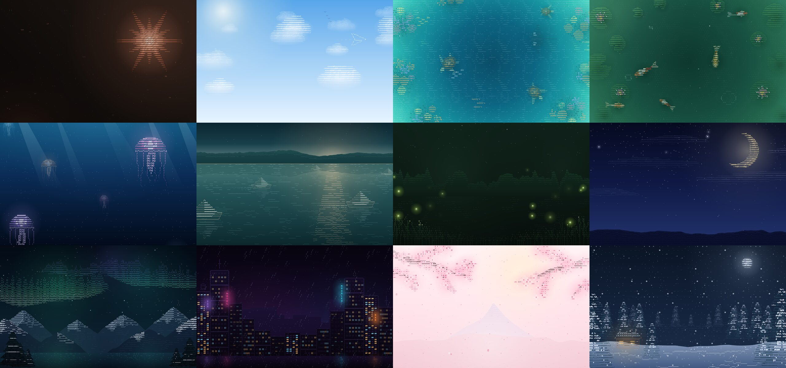

# ASCII Wallpapers for Claude

Twelve live ASCII wallpapers behind the chat in Claude Desktop. Each scene is real ASCII art, drawn in character cells that pulse, drift and flicker, and the window takes on the scene's own colours: grays tinted with its hue and panels frosted in its deep tone, so the chat stays easy to read.



**Claude Code** · **Cloud Drift** · **Honu Lagoon** · **Koi Pond** · **Jellyfish** · **Paper Boats** · **Fireflies** · **Moonlit** · **Aurora** · **Neon Rain** · **Sakura** · **Snowfall**

## Install

At the prompt of a terminal session of Claude Code:

```
/plugin install ascii-wallpapers --marketplace baku01/ascii-wallpapers
```

Answer `y` to add the marketplace, then pick a scope (user scope puts it in every session).

From a shell:

```bash
claude plugin install ascii-wallpapers --marketplace baku01/ascii-wallpapers
```

In the desktop app, where `/plugin` does not run: click **+** next to the prompt box, then **Plugins**, **Add marketplace** with `baku01/ascii-wallpapers`, then **Add plugin**.

Then start a new session in the Code tab of Claude Desktop.

## Use

- `/wallpaper` opens the picker above the prompt. Click a wallpaper, or focus the picker and press `1`–`9`, `a`–`c` (`0` for off). Clawd the crab sits on it and hops when you pick one.
- `/wallpaper aurora` (or any name, such as `/wallpaper neon rain`), `/wallpaper off`.
- `/wallpaper crab off` sends Clawd to rest; `/wallpaper crab on` brings him back.
- Your pick is kept for the next session.

## Build

The scenes are generated: `scripts/scenes/` holds one module per wallpaper, and

```bash
node scripts/build.mjs                      # writes hooks/walls.js, hooks/scenes.js, hooks/colors.js
node scripts/build.mjs --only aurora --preview /tmp/aw   # one scene, as HTML pages to look at
```

A scene is rows of SVG text on a grid of 10 × 19 cells, shaded by density ramps and outline glyphs, moved and flickered by CSS animation (paused under reduced motion), and kept under the 131,072 characters a plugin's SVG may hold. Each scene's window colours come from `makeColors` (`scripts/vendor/make-colors.js`, from Claude Code's plugin-authoring skill) with grays tinted by the scene's hue.

## Notes

- Wallpapers draw in Claude Code sessions in Claude Desktop (and the mobile app). The Chat tab is claude.ai, where plugins don't run, and the terminal keeps its own look.
- One theme at a time: turn off any other plugin that sets a theme.
- Needs a Claude Code version whose desktop app draws plugin backdrops (2.1.325 or later).

## Remove

```bash
claude plugin uninstall ascii-wallpapers
```

## Credits

Made by Pedro Correa. Based on [Handsher's ASCII Wallpapers](https://github.com/Handsher/ascii-wallpapers) and its concept film (https://x.com/handsher_NGU/status/2121399044560015748), whose wallpapers, picker and Clawd this grew from.

MIT License.
