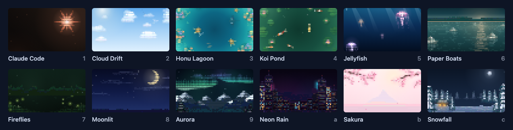
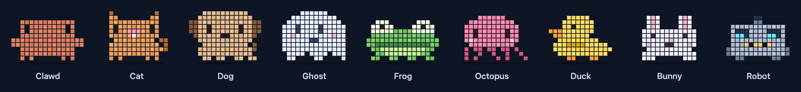

# ASCII Wallpapers para o Claude

Doze papéis de parede ASCII animados atrás do chat no Claude Desktop. Cada cena é arte ASCII de verdade, desenhada em células de caracteres que pulsam, flutuam e cintilam. A janela assume as cores da própria cena, com cinzas tingidos pelo matiz dela e painéis foscos no seu tom mais profundo, e o chat continua fácil de ler.


**Claude Code** · **Cloud Drift** · **Honu Lagoon** · **Koi Pond** · **Jellyfish** · **Paper Boats** · **Fireflies** · **Moonlit** · **Aurora** · **Neon Rain** · **Sakura** · **Snowfall**

## Instalação

No prompt de uma sessão do Claude Code no terminal:

```
/plugin install ascii-wallpapers --marketplace baku01/ascii-wallpapers
```

Responda `y` para adicionar o marketplace e escolha um escopo (o escopo de usuário vale para todas as sessões).

Pelo shell:

```bash
claude plugin install ascii-wallpapers --marketplace baku01/ascii-wallpapers
```

No app desktop, onde `/plugin` não roda: clique em **+** ao lado da caixa do prompt, depois em **Plugins**, **Add marketplace** com `baku01/ascii-wallpapers` e, por fim, **Add plugin**.

Depois, abra uma sessão nova na aba Code do Claude Desktop.

## Uso

- `/wallpaper` abre o seletor acima do prompt. Clique num papel de parede ou, com o seletor em foco, use as teclas `1`–`9` e `a`–`c` (`0` desliga).
- `/wallpaper aurora` (ou qualquer nome, como `/wallpaper neon rain`) e `/wallpaper off`.
- Sua escolha fica guardada para a próxima sessão.



### Pets

Um pet fica na borda do prompt e pula quando você escolhe um papel de parede. Além do Clawd, o caranguejo, há mais oito pets no mesmo estilo de pixel art: gato, cachorro, fantasma, sapo, polvo, pato, coelho e robô. Cada um tem seus quadros de animação (rabo, piscar, tentáculos, antena), flutua e solta faíscas ao pular.



- Escolha na fileira **Pets** do seletor (teclas `q`–`o`, `p` para nenhum).
- Ou pelo comando: `/wallpaper pet cat`, `/wallpaper pet robot`, `/wallpaper pet off`.
- `/wallpaper crab on|off` continua funcionando.

## Como as cenas são feitas

As cenas são geradas: `scripts/scenes/` tem um módulo por papel de parede.

```bash
node scripts/build.mjs                                   # gera hooks/walls.js, hooks/scenes.js e hooks/colors.js
node scripts/build.mjs --only aurora --preview /tmp/aw   # uma cena, como páginas HTML para conferir
```

- **Arte:** cada cena é feita de linhas de texto SVG numa grade de células de 10 × 19, sombreadas por rampas de densidade e glifos de contorno.
- **Animação:** CSS move as peças continuamente e funde um quadro no outro, com pausa quando o sistema pede movimento reduzido.
- **Tamanho:** cada cena fica abaixo dos 131.072 caracteres que o SVG de um plugin pode ter.
- **Limites do Desktop:** o Claude Desktop descarta uma cena complexa demais. O build reprova a cena antes disso (nomes de propriedades CSS vezes colchetes abertos, aninhamento de tags, pinturas, links). No texto, `\ ( ) [ ] { } -` viram sósias da mesma largura, para a arte ASCII caber nesses limites.
- **Desempenho:** o Desktop também congela uma cena cujos quadros custam caro demais para checar. Por isso a cena deve ficar em poucos milissegundos por quadro: sem `textLength` e com pouco detalhe nos planos distantes.
- **Cores:** as cores da janela de cada cena vêm de `makeColors` (`scripts/vendor/make-colors.js`, da skill de criação de plugins do Claude Code), com os cinzas tingidos pelo matiz da cena.

## Observações

- Os papéis de parede aparecem nas sessões do Claude Code no Claude Desktop (e no app mobile). A aba Chat é o claude.ai, onde plugins não rodam, e o terminal mantém o visual dele.
- Um tema por vez: desative qualquer outro plugin que defina tema.
- Exige uma versão do Claude Code cujo app desktop desenhe fundos de plugins (2.1.325 ou mais nova).

## Remover

```bash
claude plugin uninstall ascii-wallpapers
```

## Créditos

Feito por Pedro Correa. Baseado no [ASCII Wallpapers do Handsher](https://github.com/Handsher/ascii-wallpapers) e no filme conceitual dele (https://x.com/handsher_NGU/status/2121399044560015748), de onde vieram os papéis de parede, o seletor e o Clawd.

Licença MIT.
